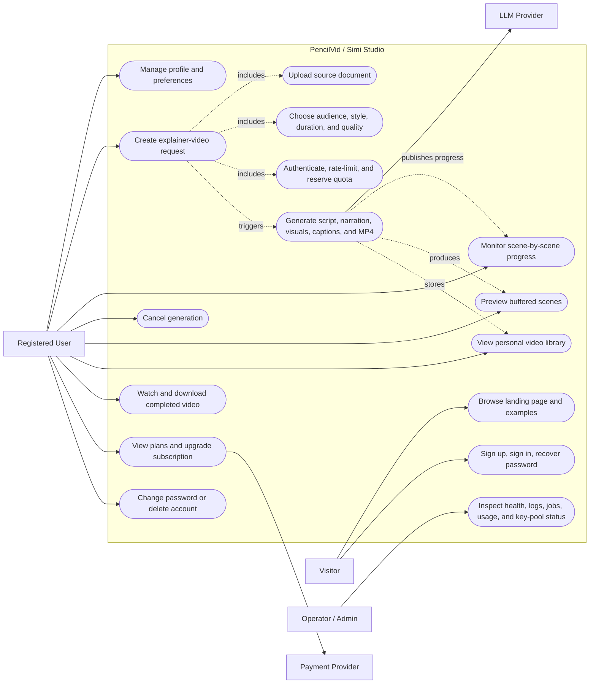
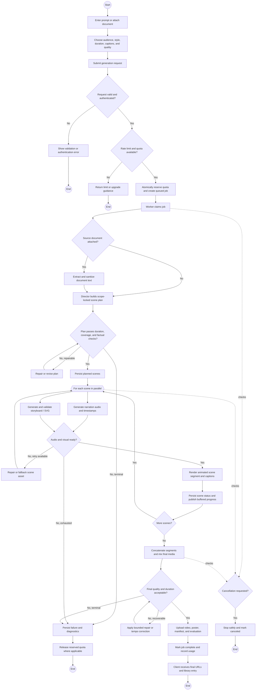
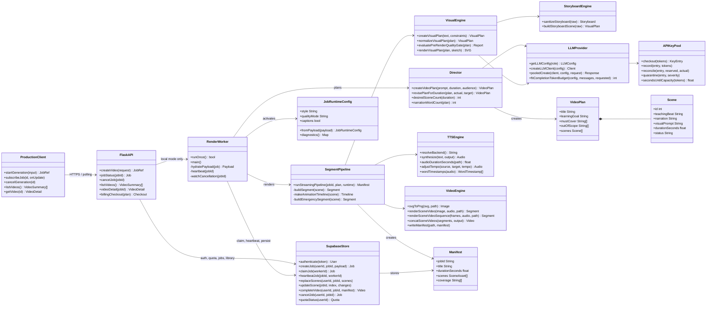
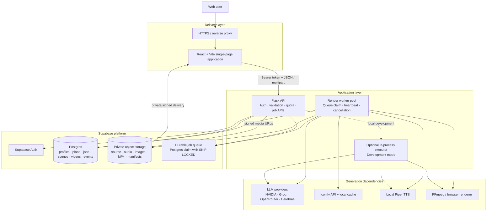
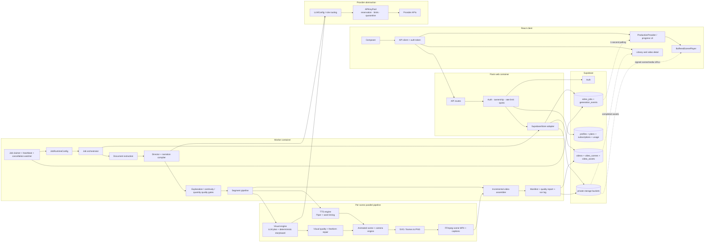
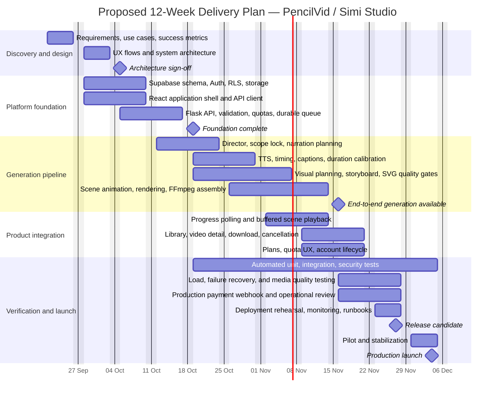

# PencilVid / Simi Studio — System Diagram Pack

This pack documents the current repository architecture and the primary video-generation workflow. The diagrams are written in Mermaid so they remain version-controlled, reviewable, and easy to export from Mermaid-compatible editors.

## Scope and assumptions

- The product name varies across the repository (`PencilVid`, `Simi Studio`, and `Explainora`). These diagrams use **PencilVid / Simi Studio** as the neutral system label.
- Production uses the durable Supabase queue and a separate worker. Local development may execute jobs in-process.
- The project timeline is a **proposed 12-week delivery plan**, starting 21 September 2026. It is not a reconstruction of repository history.
- Billing currently includes demo-oriented flows in parts of the implementation; production payment-provider webhook integration is shown as a hardening task.

## Diagram index

1. [Use Case Diagram](use-case-diagram.mmd)
2. [Video Generation Activity Diagram](activity-diagram.mmd)
3. [Class Diagram](class-diagram.mmd)
4. [High-Level System Architecture](high-level-architecture.mmd)
5. [Low-Level Generation Architecture](low-level-architecture.mmd)
6. [Proposed Project Timeline](project-timeline.mmd)

## 1. Use Case Diagram

## 2. Activity Diagram

## 3. Class Diagram

## 4. High-Level System Architecture

## 5. Low-Level Generation Architecture

## 6. Proposed Project Timeline

